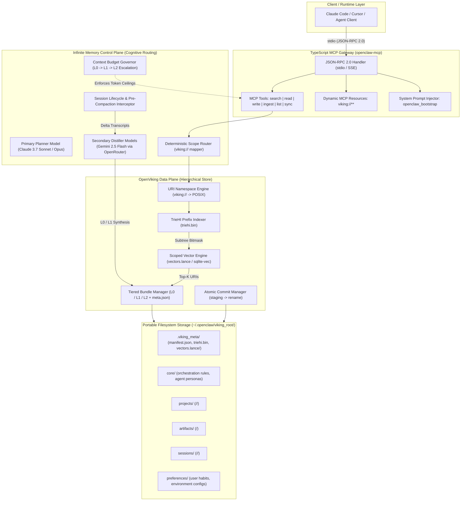
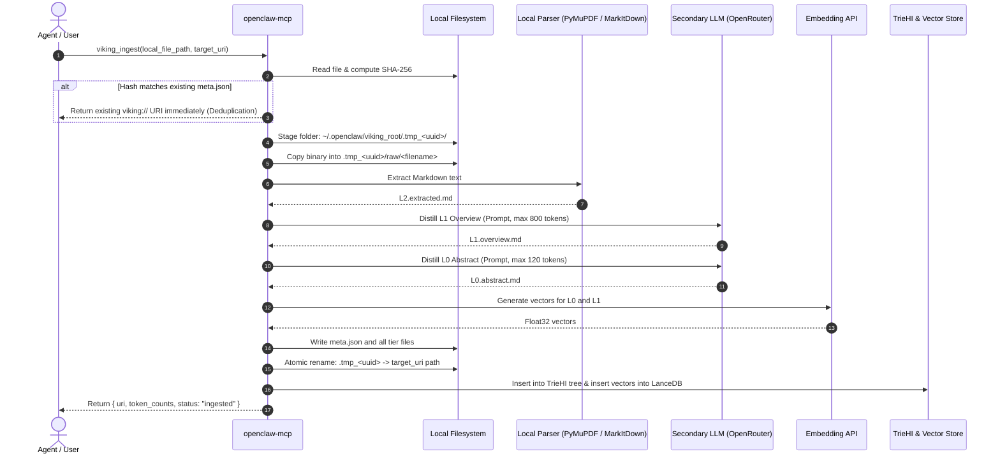

# OPENCLAW INFINITE MEMORY SPECIFICATION (V6)

> **Architectural Paradigm:** Unified Infinite Memory Multi-Model Control Plane + OpenViking Hierarchical Filesystem Data Plane + TypeScript MCP Gateway  
> **Version:** 6.0.0  
> **Status:** Production Specification & Implementation Blueprint  
> **Target Runtimes:** Claude Code, Cursor, Antigravity, OpenClaw Agent, and MCP-Compliant Multi-Agent Environments  
> **Primary Language:** TypeScript (Node.js ES Modules, TypeScript 5.7+)  

---

## Upstream Repositories & Reference Codebases

This specification represents a formal architectural convergence and merge between two primary foundational projects:

- **Infinite Memory Control Plane:** [rpcoelho17/Infinite_Memory](https://github.com/rpcoelho17/Infinite_Memory) — The original Infinite Memory plugin for OpenClaw / AntiGravityClaw developed by Rodrigo Coelho. Provides the multi-model orchestration engine, context budget governor, session delta compilation, cognitive routing, continuous ADR checkpointing, and agent lifecycle hooks.
- **OpenViking Data Plane & Filesystem (`viking://`):** [volcengine/OpenViking](https://github.com/volcengine/OpenViking) — Open-source context database and hierarchical virtual filesystem for AI agents by Volcengine. Provides the URI-addressable hierarchical storage paradigm (`viking://`), the three-tier resolution schema (L0 Abstract, L1 Overview, L2 Details), and deterministic POSIX-like directory navigation.

### Supporting Ecosystem Libraries
- **Host Project / Runtime:** [rpcoelho17/AntiGravity-Claw](https://github.com/rpcoelho17/AntiGravity-Claw) — Lean, agentic personal AI runtime, multi-model orchestrator, and infinite memory subsystem.
- **Model Context Protocol (MCP) TypeScript SDK:** [modelcontextprotocol/typescript-sdk](https://github.com/modelcontextprotocol/typescript-sdk) — Official MCP server implementation standard for Claude Code and agent tool integration.
- **Embedded Vector Backends:**
  - [lancedb/lancedb](https://github.com/lancedb/lancedb) — Embedded, serverless columnar vector database.
  - [asg017/sqlite-vec](https://github.com/asg017/sqlite-vec) — Zero-dependency embedded vector search extension for SQLite.

---

## Notice for Implementing LLMs & Engineers

This document is a **comprehensive, self-contained reference and implementation blueprint** for building the OpenClaw Infinite Memory Subsystem (V6). Every architectural boundary, storage layout, data structure, mathematical formula, network protocol, and tool schema is defined with precision. 

When generating code from this specification:
1. Adhere strictly to the **plane separation** between the Control Plane (cognitive routing, token governance) and Data Plane (filesystem storage, indexing).
2. **Never store raw text strings in the vector database.** The vector store contains only vectors, URI pointers, and lightweight metadata. All text is read from the filesystem via progressive disclosure ($L0 \to L1 \to L2$).
3. Implement atomic commits via staging directories and filesystem renames (`fs.rename`).
4. Follow the phased implementation plan detailed in Section 9.

---

## Table of Contents

1. [Executive Summary & Architectural Philosophy](#1-executive-summary--architectural-philosophy)
2. [System Topology: Control Plane vs. Data Plane](#2-system-topology-control-plane-vs-data-plane)
3. [Hierarchical Storage Schema (viking:// & L0/L1/L2)](#3-hierarchical-storage-schema-viking-and-l0l1l2)
4. [Dual-Index Engine: TrieHI + Scoped Vector Retrieval](#4-dual-index-engine-triehi--scoped-vector-retrieval)
5. [Ingestion, Distillation & Write Workflows](#5-ingestion-distillation--write-workflows)
6. [Asynchronous Session Compilation Engine](#6-asynchronous-session-compilation-engine)
7. [TypeScript MCP Server Gateway (openclaw-mcp)](#7-typescript-mcp-server-gateway-openclaw-mcp)
8. [Portability, Self-Healing & Disaster Recovery](#8-portability-self-healing--disaster-recovery)
9. [Step-by-Step Implementation Roadmap for LLMs](#9-step-by-step-implementation-roadmap-for-llms)
10. [Reference Data Schemas & Contracts](#10-reference-data-schemas--contracts)

---

## 1. Executive Summary & Architectural Philosophy

Previous memory iterations (V4/V5) relied on dual-write architectures that split state between relational databases (SQLite tables for messages, summaries, and full-text search) and external vector extensions (`sqlite-vec` or FAISS). Over long agent lifecycles, these architectures suffer from:
- **Synchronization drift** between SQL text tables and vector indices.
- **Context window flooding** caused by flat, global similarity searches that retrieve irrelevant chunks from cross-project collisions.
- **High migration overhead**, requiring complex SQL dump and restore pipelines.

**OpenClaw Infinite Memory V6** resolves these issues through a direct architectural merge:
- **Control Plane (Cognitive Routing & Orchestration):** Derived from [rpcoelho17/Infinite_Memory](https://github.com/rpcoelho17/Infinite_Memory).
- **Data Plane (Hierarchical Context Filesystem):** Derived from [volcengine/OpenViking](https://github.com/volcengine/OpenViking).

By unifying these two paradigms, V6 eliminates standalone SQL text databases while providing deterministic context scoping, progressive disclosure ($L0 \to L1 \to L2$), and zero-copy text hydration via `viking://`.

```
+---------------------------------------------------------------------------------+
|                                 CORE TENETS OF V6                               |
+---------------------------------------------------------------------------------+
| 1. Strict Plane Separation: Control Plane decides; Data Plane persists.         |
| 2. Zero SQL Text Redundancy: Posix Markdown is the single source of truth.      |
| 3. Deterministic Scoping (TrieHI): Subtree bitmasking before vector scoring.   |
| 4. Progressive Disclosure: Minimal tokens by default (L0 -> L1 -> L2).          |
| 5. Zero-Configuration Portability: Entire brain lives in one directory tree.    |
+---------------------------------------------------------------------------------+
```

### 1.1 Core Design Tenets

1. **Strict Plane Separation:** Cognitive routing, model delegation, context token governors, and agent execution policies reside exclusively in the **Control Plane** (Infinite Memory). Persistence, tiered summarization, URI routing, and deterministic path resolution reside in the **Data Plane** (OpenViking).
2. **Elimination of SQL Text Redundancy:** Standalone SQL databases for storing raw text or transcripts are deprecated. All textual knowledge is stored directly as human-readable, Git-compatible Markdown bundles alongside embedded vector sidecars.
3. **Deterministic Context Scoping:** Global similarity search across flat vector spaces is replaced by **TrieHI** (Hierarchical Trie Index) prefix filtering. Semantic retrieval is mathematically constrained to verified directory subtrees before cosine similarity scoring occurs.
4. **Progressive Context Disclosure ($L0 \to L1 \to L2$):** Agents load minimal token footprints by default ($L0$ abstracts: 50–120 tokens), escalating to structural overviews ($L1$: 300–800 tokens) and raw source payloads ($L2$: unbounded) only when task ambiguity or technical depth warrants full fidelity.
5. **Portability by Design:** The entire memory state—including binary artifacts, Markdown hierarchies, metadata, and local vector indices—is encapsulated inside a single root directory (`~/.openclaw/viking_root`), enabling zero-configuration migration via `rsync`, `tar`, or Git.

---

## 2. System Topology: Control Plane vs. Data Plane



### 2.1 Infinite Memory Control Plane (Cognitive Routing)

The Control Plane governs **how** agents reason, delegate tasks, and consume context:
- **Multi-Model Orchestration:** Divides cognitive labor between high-reasoning primary planners (e.g., Claude 3.7 Sonnet / Opus in Claude Code) and cost-optimized secondary executor models (e.g., `google/gemini-2.5-flash` or `deepseek-chat` via OpenRouter).
- **Context Budget Governor:** Intercepts large read requests, enforces progressive disclosure, and prevents context compaction amnesia by ensuring that the primary agent never loads full $L2$ files when $L0$ or $L1$ satisfies the query.
- **Deterministic Scope Router:** Converts ambient developer context (active project directory, Git branch, open file paths) into scoped `viking://` URI prefixes before queries reach the vector engine.
- **Session Lifecycle Hooks:** Monitors conversation length and compaction signals to trigger asynchronous background compilation of session deltas into permanent memory bundles.

### 2.2 OpenViking Data Plane (Hierarchical Storage Engine)

The Data Plane governs **where** and **how** data is indexed, validated, and persisted:
- **URI Namespace Engine:** Translates logical `viking://<namespace>/<domain>/<entity>` URIs to deterministic physical paths inside `~/.openclaw/viking_root/`.
- **Tiered Bundle Manager:** Manages the atomic creation and reading of context bundles ($L0$ abstract, $L1$ overview, $L2$ source/extracted, `raw/`, `meta.json`).
- **Embedded Dual-Index Engine:** Maintains two synchronized indices:
  1. An in-memory **TrieHI** radix tree for sub-millisecond prefix path pruning.
  2. An embedded **Vector Store** (LanceDB or `sqlite-vec`) storing strictly embeddings and URI pointers—never duplicated text.
- **Atomic Commit Manager:** Enforces crash consistency using temporary staging folders and atomic filesystem renames (`fs.rename`).

---

## 3. Hierarchical Storage Schema (`viking://` and L0/L1/L2)

In OpenClaw V6, every knowledge entity is stored as a **Context Bundle Directory** on disk. Flat SQL rows and unpartitioned vector collections are completely eliminated.

### 3.1 Physical Directory Hierarchy

The root directory defaults to `~/.openclaw/viking_root/` (configurable via `VIKING_ROOT_DIR` environment variable):

```text
~/.openclaw/viking_root/
├── .viking_meta/
│   ├── manifest.json             # Engine version, embedding dimensions, active model ID
│   ├── triehi.bin                # Serialized TrieHI prefix radix tree
│   └── vectors.lance/            # Embedded vector store (LanceDB / sqlite-vec table)
│
├── core/                         # Global rules, personas, behavioral contracts
│   └── orchestration_rules/
│       ├── L0.abstract.md        # ~50-100 tokens: ultra-dense index & keywords
│       ├── L1.overview.md        # ~300-800 tokens: architectural breakdown & interfaces
│       ├── L2.source.md          # Verbatim markdown content
│       └── meta.json             # Provenance, SHA-256, timestamps, token counts
│
├── projects/                     # Project knowledge, architectural ADRs, code maps
│   └── <project_slug>/
│       └── <module_slug>/
│           ├── L0.abstract.md
│           ├── L1.overview.md
│           ├── L2.source.md
│           └── meta.json
│
├── artifacts/                    # Ingested documents (PDFs, research papers, specs)
│   └── <artifact_id>/
│       ├── L0.abstract.md        # Document thesis, key topics, critical metrics
│       ├── L1.overview.md        # Section-by-section structured summary
│       ├── L2.extracted.md       # Complete extracted text / parsed Markdown
│       ├── raw/                  # Preserved binary file
│       │   └── <original_filename>.<ext>
│       └── meta.json
│
├── sessions/                     # Compiled conversation logs & execution histories
│   └── <YYYY-MM>/
│       └── <session_id>/
│           ├── L0.abstract.md    # Session intent, key decisions, outcome summary
│           ├── L1.overview.md    # Step-by-step actions, tool calls, resolved bugs
│           ├── L2.transcript.md  # Pruned, clean conversational transcript
│           └── meta.json
│
└── preferences/                  # User habits, environment setups, workflow styles
    └── <domain_slug>/
        ├── L0.abstract.md
        ├── L1.overview.md
        ├── L2.source.md
        └── meta.json
```

### 3.2 Tier Definitions, Token Budgets & Retrieval Behavior

| Tier | File Name | Token Budget | Purpose & LLM Consumption Policy |
| :--- | :--- | :--- | :--- |
| **L0 (Abstract)** | `L0.abstract.md` | **50 – 120 tokens** | Ultra-dense semantic index, entity keywords, and thesis statement. Returned by default in all searches (`viking_search`). Used for rapid multi-entity scanning with near-zero context consumption. |
| **L1 (Overview)** | `L1.overview.md` | **300 – 800 tokens** | Structured executive synthesis: architectural components, interfaces, rationale, trade-offs, and critical gotchas. Loaded when an agent identifies relevance from the L0 abstract. |
| **L2 (Detail)** | `L2.source.md` / `L2.extracted.md` / `L2.transcript.md` | **Unbounded** | Verbatim source markdown, full transcript, code source, or raw document text. Loaded exclusively when deep-dive code synthesis or exact textual citations are required. |
| **Raw Binary** | `raw/*` | **N/A (Disk only)** | Exact bit-for-bit preservation of ingested files (PDFs, images, CSVs, binaries). Never loaded directly into LLM context; accessed via local tools or OCR extractors. |

### 3.3 Bundle Metadata Schema (`meta.json`)

Every bundle directory MUST contain a `meta.json` file adhering to the following schema:

```json
{
  "$schema": "https://openclaw.ai/schemas/v6/bundle_meta.json",
  "uri": "viking://artifacts/specs/rfc-9110-http-semantics",
  "bundle_version": "6.0",
  "content_type": "application/pdf",
  "original_filename": "rfc9110.pdf",
  "sha256_source": "4a7d1ed414474e4033ac29ccb8653d9b",
  "sha256_l2": "9f86d081884c7d659a2feaa0c55ad015a3bf4f1b2b0b822cd15d6c15b0f00a08",
  "created_at": "2026-11-12T10:15:00.000Z",
  "updated_at": "2026-11-12T10:15:04.000Z",
  "distiller_model": "google/gemini-2.5-flash",
  "embedding_model": "BAAI/bge-base-en-v1.5",
  "embedding_dimension": 768,
  "token_counts": {
    "l0": 78,
    "l1": 462,
    "l2": 32800
  },
  "tags": ["rfc", "http", "networking", "protocol"],
  "access_control": "read-write",
  "custom_attributes": {
    "rfc_status": "standard",
    "replaces": "rfc7231"
  }
}
```

### 3.4 Storage Engine Root Manifest (`manifest.json`)

Located at `~/.openclaw/viking_root/.viking_meta/manifest.json`:

```json
{
  "schema_version": "6.0.0",
  "created_at": "2026-11-12T00:00:00.000Z",
  "embedding_config": {
    "provider": "local_gpu",
    "model": "BAAI/bge-base-en-v1.5",
    "dimension": 768,
    "metric": "cosine"
  },
  "distiller_config": {
    "provider": "openrouter",
    "model": "google/gemini-2.5-flash",
    "max_tokens_l0": 120,
    "max_tokens_l1": 800
  },
  "index_stats": {
    "total_bundles": 142,
    "total_vectors": 284,
    "last_compacted": "2026-11-12T12:00:00.000Z"
  }
}
```

---

## 4. Dual-Index Engine: TrieHI + Scoped Vector Retrieval

Traditional flat vector databases degrade sharply in precision as repository size grows because semantically similar phrases across disparate projects trigger false positives. OpenClaw V6 solves this with a **two-stage hybrid retrieval architecture**.

```
+---------------------------------------------------------------------------------+
|                        TWO-STAGE RETRIEVAL PIPELINE                             |
+---------------------------------------------------------------------------------+
|                                                                                 |
|  User Query: "How does JWT authentication work?"                                |
|  Scope:      "viking://projects/core-api/"                                      |
|                                                                                 |
|  [STAGE 1: TrieHI Radix Prefix Filter]                                          |
|      Root                                                                       |
|       └── projects/                                                             |
|            └── core-api/  <-- MATCH: Bitmask generated in O(k) time             |
|                 ├── auth/         [Bundle ID: #101]                             |
|                 └── middleware/   [Bundle ID: #102]                             |
|                                                                                 |
|  [STAGE 2: Scoped Vector Cosine Scoring]                                        |
|      Search vectors WHERE bundle_uri IN (#101, #102)                            |
|      Calculate Hybrid Score: alpha*cos(L0) + (1-alpha)*cos(L1) + RecencyDecay     |
|                                                                                 |
|  [STAGE 3: Zero-Copy Text Hydration]                                            |
|      Read L0.abstract.md directly from POSIX disk via mmap                      |
|                                                                                 |
+---------------------------------------------------------------------------------+
```

### 4.1 Stage 1: TrieHI (Hierarchical Trie Index) Prefix Filtering

TrieHI is an in-memory prefix radix tree persisted to `.viking_meta/triehi.bin`. It indexes all URI segments and maintains fast membership bitmasks of descendant bundle IDs.

#### TrieHI Node Specification
```typescript
interface TrieHINode {
  segment: string;                     // e.g., "projects", "core-api", "auth"
  fullUriPrefix: string;               // e.g., "viking://projects/core-api/auth"
  bundleId?: string;                   // Defined if this node is an atomic bundle
  children: Map<string, TrieHINode>;   // Subtree branches
  descendantBundleIds: Set<string>;    // Precomputed set of all descendant bundle IDs
  bloomKeywords?: Uint8Array;          // 256-bit Bloom filter of L0 keywords
}
```

#### TrieHI Operational Guarantees
1. **$O(k)$ Resolution Time:** Where $k$ is the depth of the `scope_uri` path segments. Resolving the candidate set for `viking://projects/finance/` takes sub-millisecond execution regardless of whether the index contains 100 or 100,000 bundles.
2. **Deterministic Pruning:** If a user specifies `scope_uri: "viking://projects/openclaw"`, 100% of nodes under `viking://artifacts/` or `viking://projects/other/` are pruned **prior** to running any vector distance calculations.
3. **Dynamic Tree Traversals (`viking_list`):** Directory trees can be inspected hierarchically without invoking embedding models or consuming vector search compute.

### 4.2 Stage 2: Scoped Vector Search Engine

The embedded vector store is stored in `.viking_meta/vectors.lance/` (or an embedded `sqlite-vec` virtual table). 

#### Vector Store Table Schema
```sql
CREATE TABLE IF NOT EXISTS viking_vectors (
  bundle_uri TEXT NOT NULL,          -- e.g., "viking://projects/openclaw/auth"
  tier TEXT NOT NULL,                -- "L0" or "L1"
  chunk_index INTEGER NOT NULL,      -- 0 for single-chunk summaries
  vector FLOAT[768] NOT NULL,        -- Normalized float32 embedding (BGE-Base-en-v1.5, 768 dims)
  updated_at INTEGER NOT NULL,       -- Unix epoch timestamp in milliseconds
  PRIMARY KEY (bundle_uri, tier, chunk_index)
);
CREATE INDEX IF NOT EXISTS idx_vec_uri ON viking_vectors (bundle_uri);
```

> **CRITICAL INVARIANT:** No raw text strings are ever stored in `viking_vectors`. Text is read directly from the POSIX filesystem (`L0.abstract.md` or `L1.overview.md`) using the `bundle_uri` pointer.

#### Hybrid Scoring & Reranking Formulation

For a search query $q$ and candidate bundle $d$ within the TrieHI scope:

$$\text{Score}(q, d) = \alpha \cdot \cos(\mathbf{v}_q, \mathbf{v}_{d, L0}) + (1 - \alpha) \cdot \cos(\mathbf{v}_q, \mathbf{v}_{d, L1}) + \beta \cdot \text{RecencyDecay}(t_d)$$

Where:
- $\cos(\mathbf{u}, \mathbf{v}) = \frac{\mathbf{u} \cdot \mathbf{v}}{\|\mathbf{u}\|_2 \|\mathbf{v}\|_2}$ (cosine similarity).
- $\mathbf{v}_{d, L0}$ is the embedding of `L0.abstract.md`.
- $\mathbf{v}_{d, L1}$ is the embedding of `L1.overview.md` (or top chunk).
- $\alpha \in [0, 1]$ controls tier weighting. **Default:** $\alpha = 0.65$ (prioritizing high-level abstract alignment while rewarding specific structural matches).
- $\beta$ is the recency coefficient. **Default:** $\beta = 0.10$.
- $\text{RecencyDecay}(t_d)$ is defined by exponential half-life decay:

$$\text{RecencyDecay}(t_d) = \exp\left( -\frac{\ln(2)}{\tau} \cdot \Delta t \right)$$

Where $\Delta t$ is the elapsed time in days since bundle update, and $\tau$ is the half-life parameter (default: $\tau = 30$ days).

---

## 5. Ingestion, Distillation & Write Workflows

### 5.1 Binary & Document Ingestion Pipeline (`viking_ingest`)

When ingesting documents (PDFs, Markdown, source code, RFCs, datasets):



### 5.2 Direct Content Writing (`viking_write`)

When an agent records an architectural decision record (ADR), bug resolution, or core guideline:

1. **Staging:** The server writes `L2.source.md` and draft `meta.json` into a temporary directory `.tmp_staging_<uuid>`.
2. **Distillation Execution:**
   - If `sync_index: true`, the distillation of `L1.overview.md` and `L0.abstract.md` runs immediately before the tool call resolves.
   - If `sync_index: false` (default for low-latency interactive sessions), a minimal temporary `L0` (derived from the first 100 words) is staged, and a background worker queues full distillation.
3. **Atomic Commit:** The temporary folder is atomically renamed to the target POSIX directory.
4. **Index Synchronization:** TrieHI is updated in memory and appended to `triehi.bin`; vectors are inserted into `vectors.lance`.

### 5.3 Distillation Prompt Templates

The secondary distiller model (e.g., `google/gemini-2.5-flash`) MUST use standardized prompts to guarantee predictable token budgets.

#### L1 Overview Distillation Prompt
```text
SYSTEM: You are the OpenClaw Context Distillation Engine. Your objective is to synthesize raw text (L2) into a high-density, structured architectural overview (L1).
RULES:
1. Target length: strictly between 300 and 800 tokens.
2. Structure:
   - ## Core Purpose & Thesis (2-3 sentences)
   - ## Key Architecture & Components (bullet points)
   - ## Critical Interfaces, Decisions & Rationale
   - ## Gotchas, Dependencies & Invariants
3. Do not include conversational filler or meta-announcements. Output raw Markdown only.

SOURCE TEXT (L2):
{{l2_content}}
```

#### L0 Abstract Distillation Prompt
```text
SYSTEM: You are the OpenClaw Context Distillation Engine. Your objective is to synthesize an L1 overview into an ultra-dense L0 semantic abstract.
RULES:
1. Target length: strictly between 50 and 120 tokens.
2. Structure:
   - Single-sentence core thesis statement.
   - Keywords / Topic Anchors: [Comma-separated technical terms, APIs, concepts].
   - Scoping Context: [Namespaces, related modules, applicable domains].
3. Output raw Markdown only.

L1 OVERVIEW:
{{l1_content}}
```

---

## 6. Asynchronous Session Compilation Engine

To prevent Claude Code’s compaction cycle from dropping critical design context, OpenClaw V6 runs a non-blocking background compilation loop.

```
Active Session Timeline (Claude Code)
===================================================================================
Time 0:00                     Time 0:45                      Time 1:15
[Session Start] ------------> [Milestone: ADR Created] ----> [Compaction Warning]
                                  │                               │
                                  ▼                               ▼
                             viking_write()                Trigger Session
                             commits decision              Delta Compilation
                             to projects/decisions/        (Non-blocking background)
                                                                  │
                                                                  ▼
                                                      Worker extracts:
                                                      - Resolved bugs
                                                      - Code conventions
                                                      - Commits session bundle:
                                                        viking://sessions/2026-11/s_4a2/
```

### 6.1 Incremental Checkpointing

Agents are instructed via system prompts to record discrete facts, ADRs, and debugging solutions immediately as they occur via `viking_write`, rather than deferring to the end of the session.

### 6.2 Pre-Compaction & Session-End Hooks

1. When a session approaches token limits (e.g., >150k tokens) or receives a `/compact` signal, the client runtime dumps the recent message history to `~/.openclaw/queue/delta_<session_id>.json`.
2. An asynchronous background process (`openclaw-compile-worker`) polls this queue.
3. The background worker:
   - Strips conversational chit-chat, boilerplate tool call logs, and duplicate error traces.
   - Identifies architectural decisions, newly introduced functions, and user preferences.
   - Updates existing `projects/<project_slug>/` bundles if modified.
   - Formats a permanent archive bundle at `viking://sessions/<YYYY-MM>/<session_id>/` containing `L0.abstract.md`, `L1.overview.md`, `L2.transcript.md`, and `meta.json`.
4. Claude Code’s interactive execution is **never blocked** by compilation or embedding overhead.

---

## 7. TypeScript MCP Server Gateway (`openclaw-mcp`)

The `openclaw-mcp` gateway connects Claude Code, Cursor, and any MCP-compliant client to OpenViking over standard input/output (`stdio`) using JSON-RPC 2.0.

### 7.1 Claude Code Configuration File

Add the server to `~/.claude/mcp_servers.json` (or `.claude/mcp_servers.json` inside a project root):

```json
{
  "mcpServers": {
    "openclaw-infinite-memory": {
      "command": "node",
      "args": ["/opt/openclaw/mcp-server/dist/index.js"],
      "env": {
        "VIKING_ROOT_DIR": "${HOME}/.openclaw/viking_root",
        "OPENROUTER_API_KEY": "${OPENROUTER_API_KEY}",
        "DISTILLER_MODEL": "google/gemini-2.5-flash",
        "EMBEDDING_MODEL": "BAAI/bge-base-en-v1.5",
        "EMBEDDING_DIM": "768",
        "LOG_LEVEL": "info"
      }
    }
  }
}
```

### 7.2 Tool Specifications

#### 1. `viking_search`
Performs TrieHI prefix-scoped semantic search and returns L0 abstracts by default.

```typescript
export interface VikingSearchInput {
  /** Natural language query or technical terms */
  query: string;
  /** Optional TrieHI prefix filter, e.g. 'viking://projects/openclaw' */
  scope_uri?: string;
  /** Maximum number of bundles to return (default: 8, max: 25) */
  limit?: number;
  /** If true, includes L1.overview.md alongside L0 in the response (default: false) */
  include_l1?: boolean;
}

export interface VikingSearchResult {
  uri: string;
  score: number;
  token_counts: { l0: number; l1: number; l2: number };
  tags: string[];
  updated_at: string;
  l0_abstract: string;
  l1_overview?: string;
}
```

#### 2. `viking_read`
Reads a specific bundle at a designated resolution tier ($L0$, $L1$, or $L2$).

```typescript
export interface VikingReadInput {
  /** Target URI, e.g. 'viking://projects/openclaw/auth' */
  uri: string;
  /** Resolution tier to read */
  tier: "L0" | "L1" | "L2";
  /** Optional character offset range [start, end] for reading large L2 files */
  range?: [number, number];
}

export interface VikingReadResult {
  uri: string;
  tier: "L0" | "L1" | "L2";
  content: string;
  token_count: number;
  total_l2_tokens: number;
  metadata: {
    content_type: string;
    updated_at: string;
    sha256: string;
  };
}
```

#### 3. `viking_write`
Creates or replaces a knowledge bundle, triggering automatic distillation and indexing.

```typescript
export interface VikingWriteInput {
  /** Target URI, e.g. 'viking://projects/alpha/auth-spec' */
  uri: string;
  /** Complete Markdown text to write (stored as L2.source.md) */
  content: string;
  /** Write mode: 'replace' overwrites; 'append' appends to L2 before distillation */
  mode: "replace" | "append";
  /** Optional metadata tags */
  tags?: string[];
  /** If true, blocks until L0/L1 distillation and vector embedding are complete (default: false) */
  sync_index?: boolean;
}

export interface VikingWriteResult {
  uri: string;
  status: "committed" | "queued_for_distillation";
  token_counts: { l0: number; l1: number; l2: number };
  sha256: string;
}
```

#### 4. `viking_ingest`
Ingests a local file (PDF, code file, text document, CSV) into the hierarchical store.

```typescript
export interface VikingIngestInput {
  /** Absolute path to source file on disk */
  local_file_path: string;
  /** Target URI destination, e.g. 'viking://artifacts/specs/rfc-9110' */
  target_uri: string;
  /** If true, stores the original file in raw/ (default: true) */
  preserve_raw?: boolean;
  /** Optional metadata tags */
  tags?: string[];
}

export interface VikingIngestResult {
  uri: string;
  original_filename: string;
  content_type: string;
  token_counts: { l0: number; l1: number; l2: number };
  sha256: string;
}
```

#### 5. `viking_list`
Traverses the TrieHI directory tree without running vector embeddings.

```typescript
export interface VikingListInput {
  /** Root URI prefix to list, e.g. 'viking://projects/' or 'viking://' */
  uri_prefix: string;
  /** Traversal depth (default: 2) */
  depth?: number;
}

export interface VikingListEntry {
  uri: string;
  is_bundle: boolean;
  child_count: number;
  token_counts?: { l0: number; l1: number; l2: number };
  updated_at?: string;
}

export interface VikingListResult {
  entries: VikingListEntry[];
  total_bundles_in_scope: number;
}
```

#### 6. `viking_sync`
Forces re-synchronization of TrieHI and vector indices with the physical filesystem.

```typescript
export interface VikingSyncInput {
  /** Optional scope URI to synchronize (default: 'viking://') */
  scope_uri?: string;
  /** If true, checks file hashes and re-distills missing L0/L1 summaries */
  repair?: boolean;
}

export interface VikingSyncResult {
  synced_bundles: number;
  reindexed_vectors: number;
  repaired_bundles: number;
  duration_ms: number;
}
```

### 7.3 Native MCP Resources

The MCP server exposes dynamic resources matching `viking://{namespace}/{path}`:
- **URI Template:** `viking://{namespace}/{path}`
- **Behavior:** Returns `L0.abstract.md` concatenated with `L1.overview.md` as formatted Markdown text.
- **Client Integration:** Allows developers using Claude Code or Cursor to type `@viking://projects/openclaw/auth` directly in chat to hydrate context without manual tool invocation.

### 7.4 MCP System Prompt Injection (`openclaw_bootstrap`)

The server provides a standardized prompt template registered as `openclaw_bootstrap`. Clients load this prompt at session start:

```markdown
# OPENCLAW INFINITE MEMORY BOOTSTRAP RULES

You have access to the OpenClaw Infinite Memory system via the `viking_*` tools. Follow these rules strictly:

1. **Orientation on Launch:**
   - Call `viking_list` on `viking://core/` and `viking://projects/<current_project>/` to discover existing architecture and conventions.
2. **Progressive Context Retrieval:**
   - Search with `viking_search` using an explicit `scope_uri`.
   - Never load L2 directly. Read L0 first. If L0 confirms relevance, call `viking_read` with `tier: "L1"`. Only escalate to `tier: "L2"` if precise code syntax or raw data is strictly required.
3. **Continuous Knowledge Commit:**
   - When you resolve a bug, establish an architectural pattern, or make a key design decision, call `viking_write` immediately to record the finding under `viking://projects/<current_project>/decisions/<slug>`.
   - Do not defer recording decisions to the end of the conversation.
```

---

## 8. Portability, Self-Healing & Disaster Recovery

### 8.1 Zero-Configuration Migration

Because the filesystem is the single source of truth and no external SQL server is required:
```bash
# Backup the entire memory state
tar -czf openclaw_viking_backup.tar.gz -C ~/.openclaw viking_root

# Restore on a new machine
mkdir -p ~/.openclaw
tar -xzf openclaw_viking_backup.tar.gz -C ~/.openclaw
```
All raw files, Markdown tiers, metadata, Bloom filters, and vector tables are preserved without database export/import scripts.

### 8.2 Self-Healing Reindexer (`openclaw-mcp --reindex`)

If `.viking_meta/` is deleted, corrupted, or if an embedding model migration occurs:
1. The engine scans all directories under `~/.openclaw/viking_root/` excluding `.viking_meta/`.
2. Reads every `meta.json`, `L0.abstract.md`, and `L1.overview.md`.
3. Reconstructs the TrieHI tree in memory and writes a clean `.viking_meta/triehi.bin`.
4. Re-computes embeddings for `L0` and `L1` (using batch requests) and writes a clean `.viking_meta/vectors.lance/`.
5. Updates `.viking_meta/manifest.json`.

---

## 9. Step-by-Step Implementation Roadmap for LLMs

When tasked with building OpenClaw Infinite Memory V6, execute in the following sequential order:

```
[Phase 1: Project Setup & Types]
    ├── Initialize TypeScript package (Node.js ESM, tsconfig.json)
    └── Define all data interfaces (BundleMeta, Manifest, MCP Inputs/Outputs)
         │
         ▼
[Phase 2: Data Plane Storage Engine]
    ├── Implement URI path resolver (viking:// -> POSIX mapping)
    ├── Implement Atomic Commit Manager (staging dir + fs.rename)
    └── Implement Bundle Manager (CRUD for L0, L1, L2, raw, meta.json)
         │
         ▼
[Phase 3: TrieHI Indexer]
    ├── Implement in-memory Radix Trie data structure
    ├── Implement subtree scope bitmask filtering ($O(k)$ lookup)
    └── Implement binary serialization/deserialization (triehi.bin)
         │
         ▼
[Phase 4: Scoped Vector Engine]
    ├── Integrate embedded vector store (LanceDB / sqlite-vec)
    ├── Implement embedding client (OpenRouter / local)
    └── Implement hybrid scoring formula (alpha*L0 + (1-alpha)*L1 + recency)
         │
         ▼
[Phase 5: Distillation Worker & Ingest Pipelines]
    ├── Implement file parsers (Markdown extraction for PDFs, code, docs)
    ├── Implement LLM distillation client with strict token enforcement
    └── Implement viking_ingest and viking_write workflows
         │
         ▼
[Phase 6: TypeScript MCP Server Gateway]
    ├── Implement MCP Server with stdio transport (@modelcontextprotocol/sdk)
    ├── Register all 6 viking_* tools with JSON schemas
    ├── Register dynamic viking:// resources
    └── Register openclaw_bootstrap prompt template
         │
         ▼
[Phase 7: CLI, Self-Healing & Verification]
    ├── Build CLI commands: --reindex, --doctor, --sync
    └── Run end-to-end integration test suite
```

### Phase Details

#### Phase 1: Environment & Type Definitions
- Create `package.json` with `@modelcontextprotocol/sdk`, `@lancedb/lancedb` (or `sqlite-vec` + `better-sqlite3`), `dotenv`, `zod`.
- Configure `tsconfig.json` with `"module": "NodeNext"`, `"target": "ES2022"`, `"strict": true`.
- Implement `src/types/schema.ts` containing all types from Section 10.

#### Phase 2: OpenViking Storage Engine
- Implement `src/storage/uri.ts`: Validates and parses `viking://<namespace>/<domain>/<entity>`.
- Implement `src/storage/atomic.ts`: Creates `.tmp_staging_<uuid>`, writes files, calls `fs.rename()`.
- Implement `src/storage/bundle.ts`: Reads and writes bundle components with SHA-256 calculation.

#### Phase 3: TrieHI Indexer
- Implement `src/indexer/triehi.ts`: Implements `TrieHI` class with `insert()`, `remove()`, `findSubtree()`, `list()`.
- Implement binary persistence: Serialize the node tree to compact binary format in `triehi.bin`.

#### Phase 4: Scoped Vector Engine
- Implement `src/indexer/vector.ts`: Initializes LanceDB table schema.
- Implement `src/indexer/embed.ts`: Batch-generates float32 embeddings with caching and retry logic.
- Implement `src/indexer/search.ts`: Queries candidate bundle IDs from TrieHI, filters vector store, computes cosine similarity, applies recency decay, and sorts results.

#### Phase 5: Ingestion & Distillation Engine
- Implement `src/distiller/worker.ts`: Wraps OpenRouter API with prompts for L1 (max 800 tokens) and L0 (max 120 tokens).
- Implement `src/ingest/parser.ts`: Extracts text from PDF, Markdown, and source code.
- Implement `src/ingest/pipeline.ts`: Coordinates hash checking, raw file saving, distillation, and atomic bundle commit.

#### Phase 6: MCP Server Gateway
- Implement `src/mcp/server.ts`: Uses MCP TypeScript SDK to expose tools, resources, and prompts over `stdio`.
- Wire tools to storage and indexing modules.

#### Phase 7: CLI & Verification Suite
- Implement `src/cli/index.ts`: Supports flags `--reindex`, `--doctor`, `--sync`, `--version`.
- Write unit tests for URI resolution, TrieHI prefix pruning, atomic bundle writes, and search reranking.

---

## 10. Reference Data Schemas & Contracts

### 10.1 Complete TypeScript Domain Interfaces (`src/types/schema.ts`)

```typescript
/**
 * OpenClaw Infinite Memory V6 - TypeScript Type Contracts
 */

export type MemoryNamespace = "core" | "projects" | "artifacts" | "sessions" | "preferences";
export type ResolutionTier = "L0" | "L1" | "L2";

export interface BundleMeta {
  $schema?: string;
  uri: string;
  bundle_version: "6.0";
  content_type: string;
  original_filename?: string;
  sha256_source?: string;
  sha256_l2: string;
  created_at: string;
  updated_at: string;
  distiller_model: string;
  embedding_model: string;
  embedding_dimension: number;
  token_counts: {
    l0: number;
    l1: number;
    l2: number;
  };
  tags: string[];
  access_control: "read-only" | "read-write";
  custom_attributes?: Record<string, unknown>;
}

export interface RootManifest {
  schema_version: "6.0.0";
  created_at: string;
  embedding_config: {
    provider: "openrouter" | "local" | "openai";
    model: string;
    dimension: number;
    metric: "cosine" | "l2";
  };
  distiller_config: {
    provider: "openrouter" | "local" | "google";
    model: string;
    max_tokens_l0: number;
    max_tokens_l1: number;
  };
  index_stats: {
    total_bundles: number;
    total_vectors: number;
    last_compacted: string;
  };
}

export interface VectorRecord {
  bundle_uri: string;
  tier: "L0" | "L1";
  chunk_index: number;
  vector: number[];
  updated_at: number;
}

export interface SearchOptions {
  query: string;
  scope_uri?: string;
  limit?: number;
  include_l1?: boolean;
  alpha?: number;      // Default: 0.65
  beta?: number;       // Default: 0.10
  half_life_days?: number; // Default: 30
}

export interface SearchResultItem {
  uri: string;
  score: number;
  token_counts: { l0: number; l1: number; l2: number };
  tags: string[];
  updated_at: string;
  l0_abstract: string;
  l1_overview?: string;
}
```

### 10.2 JSON Schema for `meta.json`

```json
{
  "$schema": "http://json-schema.org/draft-07/schema#",
  "title": "OpenClawBundleMeta",
  "type": "object",
  "required": [
    "uri",
    "bundle_version",
    "content_type",
    "sha256_l2",
    "created_at",
    "updated_at",
    "distiller_model",
    "embedding_model",
    "embedding_dimension",
    "token_counts",
    "tags"
  ],
  "properties": {
    "uri": {
      "type": "string",
      "pattern": "^viking://[a-z0-9_-]+(/[a-z0-9_.-]+)+$"
    },
    "bundle_version": { "type": "string", "enum": ["6.0"] },
    "content_type": { "type": "string" },
    "original_filename": { "type": "string" },
    "sha256_source": { "type": "string" },
    "sha256_l2": { "type": "string" },
    "created_at": { "type": "string", "format": "date-time" },
    "updated_at": { "type": "string", "format": "date-time" },
    "distiller_model": { "type": "string" },
    "embedding_model": { "type": "string" },
    "embedding_dimension": { "type": "integer" },
    "token_counts": {
      "type": "object",
      "required": ["l0", "l1", "l2"],
      "properties": {
        "l0": { "type": "integer", "maximum": 150 },
        "l1": { "type": "integer", "maximum": 1000 },
        "l2": { "type": "integer" }
      }
    },
    "tags": {
      "type": "array",
      "items": { "type": "string" }
    },
    "access_control": {
      "type": "string",
      "enum": ["read-only", "read-write"],
      "default": "read-write"
    },
    "custom_attributes": { "type": "object" }
  }
}
```

---

## 11. Architectural Invariants & Anti-Patterns

When developing or executing from this specification, the implementing system MUST enforce the following operational rules:

1. **NO Raw Text in Vector Tables:** Do not add a `text` column to the vector database. Storing text in vector rows causes data synchronization drift and bloats memory files. Text belongs exclusively in the Markdown files on disk.
2. **NO Global Unscoped Vector Sweeps:** Every semantic query must be prefaced by TrieHI resolution. If no `scope_uri` is supplied by the user, default to the relevant namespace (e.g. `viking://projects/<active_project>/` or `viking://`).
3. **NO Direct L2 Hydration on Search:** `viking_search` must never return L2 source content. It returns L0 abstracts by default, and optionally L1 overviews when explicitly requested. Full L2 is only accessible via `viking_read`.
4. **NO Non-Atomic Filesystem Writes:** Never write directly to the target bundle directory. Always stage inside `.tmp_<uuid>/`, write and sync all files, and execute a single atomic `fs.rename()` to move the bundle into the live hierarchy.
5. **Deterministic Reindex Capability:** The system must be fully reconstructible from the Markdown files on disk. If `.viking_meta/` is deleted, `openclaw-mcp --reindex` must completely rebuild `triehi.bin` and `vectors.lance` without loss of knowledge.


You are an expert systems engineer. Implement the OpenClaw Infinite Memory Subsystem (V6) in TypeScript/Node.js according to the specifications in OPENCLAW_INFINITE_MEMORY_SPEC_V6.md. Execute the build sequentially starting from Phase 1 through Phase 7:

Set up the package structure and TypeScript interfaces in src/types/schema.ts.
Implement the OpenViking Data Plane storage engine (viking:// URI mapping, atomic staging writes, and bundle management).
Implement the in-memory TrieHI prefix tree indexer and binary serialization.
Implement the Scoped Vector Engine with LanceDB/sqlite-vec and hybrid cosine/recency reranking.
Implement the document ingestion parser and OpenRouter secondary model distillation worker.
Implement the TypeScript MCP Server over stdio with all 6 viking_* tools, dynamic resources, and bootstrap prompts.
Implement the CLI utilities (--reindex, --doctor, --sync) and integration tests.
